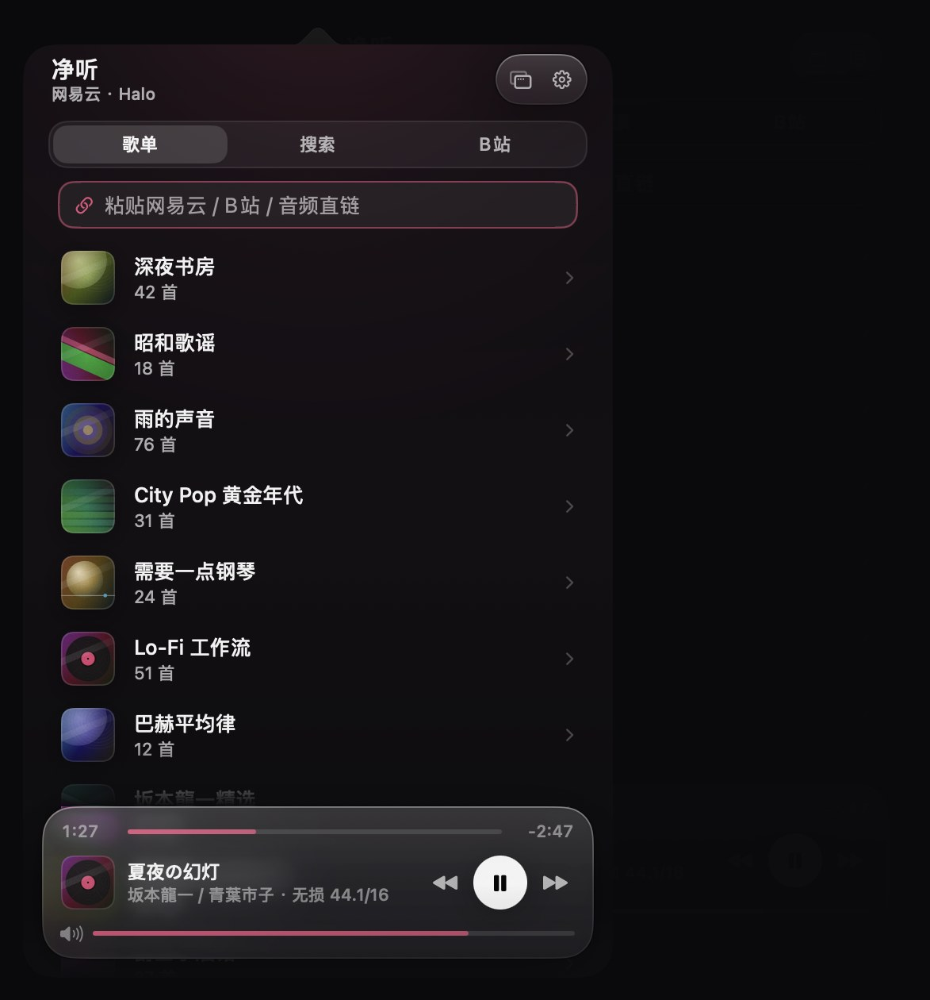
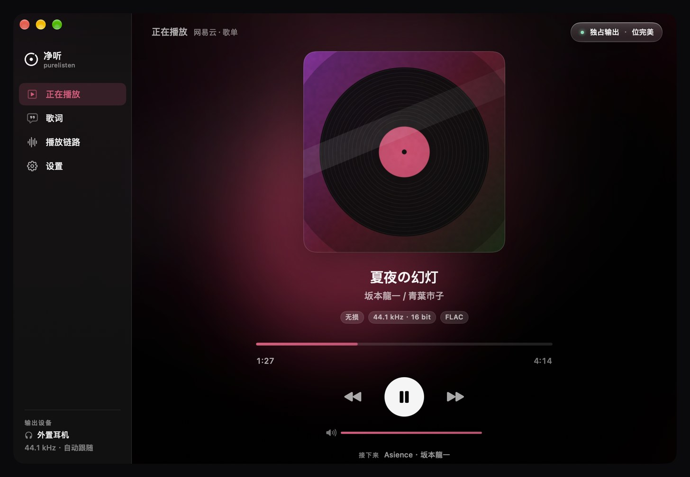

# 净听 PureListen

**网易云音乐 · 无损独占输出 · 为操作简便而生**

一款 macOS 菜单栏应用。启动它, 网易云音乐就会以**无损、无 SRC** 的方式从本机 3.5mm 耳机孔输出 —— 不需要 SoundSource, 不需要手动切采样率, 不需要 Audio MIDI Setup。

<p align="center">
  
  
</p>

> **v2.0 · macOS 27 "Golden Gate" 视觉重设计**：Liquid Glass 播放台、封面取色的氛围光、同心圆角、等宽数字、独立「正在播放」窗口与分层玻璃应用图标。
> 设计与实现说明见 [docs/design/README.md](docs/design/README.md)，设计语言研究见 [docs/research/macos27-design-language.md](docs/research/macos27-design-language.md)。

## 它解决什么问题

macOS 会把所有 App 的音频混在一起, 统一重采样 (SRC) 后输出。听无损音乐时, 这种"系统级混合重采样"会引入可闻的损失 (高频发毛、发糊)。iPhone/iPad 没有这个问题, 因为播放器会独占音频输出; 而 Mac 版网易云音乐没有独占功能。

净听的做法 (全部自动, 无需任何手动操作):

1. **hog mode 独占输出设备** —— 直接绕过 coreaudiod 系统混音器, 其他 App 的声音不再混入;
2. **每首歌自动切换采样率** —— 播放前读取音源真实采样率, 把设备标称采样率切到完全一致 (44.1/48/88.2/96 kHz), 从根源上消除 SRC;
3. **位完美直通** —— FLAC 解码后以设备原生格式直写硬件, 音量 100% 时不做任何乘法 (UI 会显示"位完美"标记);
4. **CPU 占用接近零** —— 没有 SoundSource 那种多模块绕行, 只有一条解码线程 + 一个 IOProc。

## 界面

| 菜单栏面板 | 正在播放窗口 |
|---|---|
| 顶栏 · 分段浏览 · 浮动玻璃播放台 | edge-to-edge 侧边栏 · 大封面 · 歌词 · 播放链路 |

- **菜单栏面板** (372×588)：歌单 / 搜索 / B站 三个浏览页，底部是一块浮在内容之上的 Liquid Glass 播放台 —— 列表会从玻璃下方滚过；面板同时显示采样率、位深、是否独占与位完美状态。
- **「正在播放」窗口** (940×640)：封面模糊铺满背景，左侧 edge-to-edge 侧边栏，四个页面：正在播放 / 歌词 / 播放链路 / 设置。点面板右上角或右键菜单即可打开。
- **歌词页**：当前行放大加粗、译文紧随，点击任意行跳转。
- **播放链路页**：音源 → 解码 → 缓冲 → 独占输出 → 设备 的实时信号流，末尾给出「SRC 已消除 · 位完美」结论。
- **设置页**：音质、输出设备、播放保护、B站账号、缓存、账号与退出；面板与窗口共用同一套卡片。
- **登录页**：扫码登录，二维码卡片、已确认状态、失败重试。
- **菜单栏图标**：自绘 template 图标（唱片环 + 中心点），播放时环线加粗；左键开面板，右键出原生菜单。

所有界面颜色只来自当前封面的「音乐色」+ 黑白灰；支持浅色/深色、降低透明度、减少动态效果。**界面不读取任何音频电平**，也不参与音频链路的处理。

其余截图见 [`docs/design/gallery/`](docs/design/gallery)。

## 功能

- **网易云独占无损播放**: 扫码登录、歌单、无损/Hi-Res 取链、hog mode 独占 3.5mm/任意输出设备、自动采样率切换、位完美直通
- **B站播放**: 粘贴视频链接/BV号/b23短链, 自动取最高音质 DASH 音频(192kbps), 支持分P; 支持收藏夹浏览
- **直链播放**: 粘贴任意音频直链(FLAC/MP3/M4A/WAV…)
- **链路可视化**: 正在播放窗口里实时展示 音源→解码→缓冲→独占→输出 全链路状态与 SRC 消除情况
- **音量键接管**: 独占时系统音量键本已无效, 开启接管后(需辅助功能权限)由本 App 响应
- **系统音量联动**: 同一输出设备上的音量键/滑块调节同步至 App；设备切换只重设基线 (无需权限)
- 默认 10% 安全音量；切换或重连输出后降至最多 10%，保留静音和更低音量
- **设备插拔**: 立即停止旧输出，保留曲目/进度，连接稳定后由用户点击播放；手动锁定的解码器断开后保留选择，不自动转到扬声器

## 系统要求

- **macOS 26.0 或更高**（Liquid Glass 设计系统与 `.glassEffect` 等 API 的最低要求；在 macOS 27 "Golden Gate" 上为最佳效果）
- Apple Silicon 或 Intel Mac

## 使用

```bash
./build.sh          # 构建、签名、备份旧版并保留数据安装到 /Applications/净听.app
# 仅检查构建、不安装时：PURELISTEN_NO_INSTALL=1 ./build.sh
```

每次新版默认自动安装。升级只替换应用包，保留账号、设置、网页登录资料和歌曲缓存；旧版及偏好备份位于 `~/Library/Application Support/PureListen Upgrades/`。正在运行时先正常退出，升级验证成功后重新打开；未运行时保持关闭。安装失败会恢复旧版。

1. 菜单栏出现唱片环图标, 点开扫码登录 (用网易云音乐 App 扫);
2. 选歌单, 点歌, 插上 3.5mm 耳机, 完事;
3. 之后每次启动会自动继续上次歌单并开始播放 ("设置"里可以关)。

播放时底部会实时显示: `坂本龍一 · 独占输出` + `44.1/16 · 无损 · 位完美` 徽标。

## 界面预览 / 开发

界面可以在**完全不发声**的情况下单独预览与截图（Debug 专用）：

```bash
swift build -c debug --product PureListen
BIN="$(swift build -c debug --show-bin-path)"
caffeinate -u -t 2
"$BIN/PureListen" --ui-studio --out docs/design/screens                 # 全部场景, dark + light
"$BIN/PureListen" --ui-studio --out /tmp/shots --only window            # 只看主窗口
```

`--ui-studio` 用假 `AppState`（不枚举音频设备、不联网、不启轮询）把真实的 `NSPopover` / `NSWindow` 渲染出来再抓图，因此整个设计验证过程不会发出任何声音。也可以直接运行 `tools/shoot-screens.sh` 一键重出全部截图。

## 网络与 VPN

网易云、B站 API 与音频下载默认「直接连接」，忽略系统应用层代理和 `http_proxy` / `https_proxy` / `all_proxy` 等终端代理环境变量。开发环境启用 VPN 不会使应用自动启用代理；TUN 模式的路由仍由 VPN 本身控制。

仅在手动选择「跟随系统代理」时，API 才读取系统 HTTP(S)/SOCKS 代理或终端代理环境变量，下载会话才使用系统代理。切换对新请求生效，可重新点播；API 暂不支持 PAC 自动代理。

缓存文件使用完整 URL 与请求头的 SHA-256 标识，防止同名音源串用。旧缓存保留，首次播放会建立新版缓存；签名 URL 改变也会产生新缓存，可在设置中清理。

## 说明与限制

- **需要黑胶 VIP** 才能取到无损/Hi-Res 直链 (这是网易的版权限制, 与本 App 无关); 非 VIP 自动回退到可用音质。
- **内置 3.5mm 孔最高 96 kHz**; 192 kHz 母带音源会自动降到 96 kHz 播放 (如需 192k 请在设置里选外置 USB/雷雳 DAC, App 支持选择任意输出设备)。
- 独占播放期间, **其他 App 的声音会被暂时屏蔽** (与 iPhone 接电话时的行为一致), 停止/暂停后恢复。
- 独占模式下系统音量键对耳机孔无效, 请用 App 内音量条 (100% = 位完美, 低于 100% 为数字衰减)。
- 本 App 使用网易网页端同款 weapi/eapi 接口 (逆向实现), 仅供个人学习研究; 请使用自己的账号, 理论上存在与官方客户端风控策略冲突的风险。
- 歌曲缓存位于 `~/Library/Caches/PureListen`, 可在设置中一键清除。

## 工程结构

```
Sources/
  PureListenCore/            核心库
    NCAPI/                   网易云客户端 (weapi/eapi 加密、扫码登录、歌单、直链)、B站客户端
    Audio/                   独占输出引擎 (hog mode、采样率切换、FLAC 解码、无锁环形缓冲)
  PureListen/                菜单栏 App (SwiftUI)
    Design/                  设计系统: 令牌、组件、封面取色、二维码
    Views/Popover/           菜单栏面板: 根视图、路由、浏览列表、浮动播放台
    Views/Window/            「正在播放」窗口: 外壳、侧边栏、播放页、歌词页、链路页
    Views/Settings/          设置卡片、B站登录卡
    UIPreview/               无音频 UI 预览 / 截图工作室 (Debug only)
  hogtest/                   独占输出链路自测 CLI (生成测试音并验证 hog/切率/恢复)
  apitest/                   API 连通性自测 CLI (二维码创建/轮询、取直链)
Resources/AppIcon.icns       应用图标 (macOS 27 分层玻璃风格)
docs/design/                 视觉规范、设计说明、截图、图标源文件
docs/research/               macOS 27 设计语言研究 + SDK API 速查
tools/shoot-screens.sh       一键重出界面截图
build.sh                     Release 构建 + 组装 .app + 签名验证 + 保留数据安装
tools/install-app.sh         暂存验证、旧版备份、替换失败恢复与安装后校验
```

## 自测

```bash
swift test                                      # 无声音、离线回归测试
swift build                                     # 构建 App 与诊断 CLI
BIN="$(swift build -c debug --show-bin-path)"
"$BIN/apitest" hct                               # B站公开 API 连通性，不登录
"$BIN/apitest" qr                                # 扫码登录链路
"$BIN/apitest" url <歌曲id>                        # eapi 取直链
"$BIN/hogtest" devices                           # 只读设备的虚拟/物理格式
"$BIN/hogtest" verify-silent --generated <设备ID> [第二设备ID]  # 零音量验证；可选双设备切换
"$BIN/hogtest"                                   # 独占链路测试；会出声并临时接管设备
```

回归测试覆盖系统代理策略、HTTP 超时/取消/重定向、并发下载与缓存失败、分享链接识别，以及快速切歌和分 P 队列。使用本机临时 HTTP 服务、独立缓存目录与隔离偏好；不依赖外网、登录账号或真实音频输出。

开发接管记录、验证结果与待处理问题见 [docs/development.md](docs/development.md)。

## 开源

MIT License · 作者 [Halo0sama](https://github.com/Halo0sama)

致谢: [NeriPlayer](https://github.com/cwuom/NeriPlayer)(B站登录与播放页设计参考)、[NeteaseCloudMusicApi](https://github.com/Binaryify/NeteaseCloudMusicApi)(接口协议参考)、[bilibili-API-collect](https://github.com/SocialSisterYi/bilibili-API-collect)(B站接口文档)。

界面设计参考了 Apple Human Interface Guidelines 与 macOS 27 的 Liquid Glass 设计语言；量化研究见 [docs/research](docs/research)。
